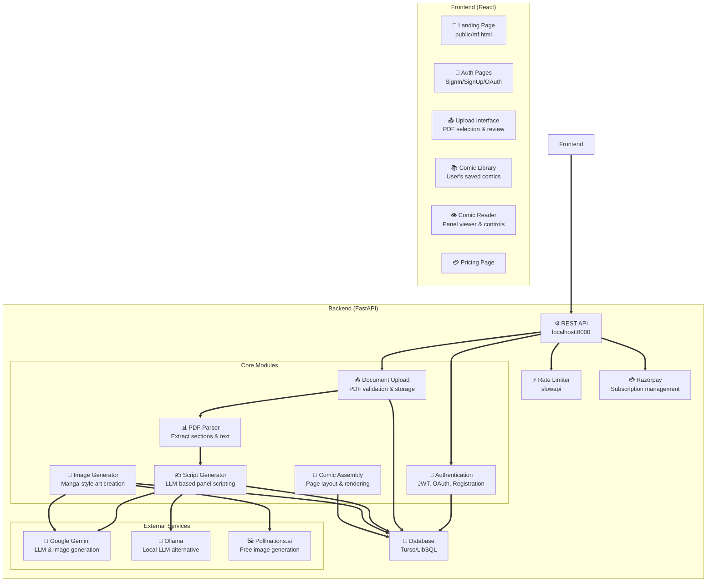

# 📚 PaperComic

Convert academic research papers into engaging manga-style visual explainers powered by AI.

[Live Demo](https://papercomicw.vercel.app) • [Report a Bug](https://github.com/Jasmine0987/papercomicw/issues) • [Request a Feature](https://github.com/Jasmine0987/papercomicw/discussions)

---

## 🎯 What is PaperComic?

PaperComic transforms dense academic PDFs into easy-to-understand comic strips. Upload a research paper, and our AI will:

1. **Extract key concepts** from your document
2. **Generate a comic script** with panels, dialogue, and scene descriptions
3. **Create manga-style illustrations** for each panel
4. **Assemble a polished comic** ready to share

Perfect for researchers, educators, and anyone who wants to make complex ideas accessible.

---

## ✨ Key Features

- 🎨 **Manga-style art generation** – AI-powered illustration in authentic comic style
- 📄 **Smart PDF parsing** – Automatically extract sections and key topics
- 🎬 **Interactive comic viewer** – Read, zoom, and share your generated comics
- 🔐 **Secure authentication** – Google OAuth and email sign-up with JWT tokens
- 💰 **Flexible pricing** – Free tier (3 generations), Pro (unlimited), and Team plans via Razorpay
- 🚀 **Rate limiting & security** – Built-in protection against abuse
- 🌍 **Multi-language support** – Generate comics in any language
- 📱 **Responsive design** – Works seamlessly on desktop and mobile

---

## 🏗️ Architecture



**Interactive diagram** – Click the nodes to explore code:
- 🔐 [Authentication](frontend/src/pages/auth) – Frontend auth pages
- 📤 [Upload](frontend/src/pages/upload) – PDF upload interface  
- ✍️ [Script Generation](backend/app/main.py#L495) – LLM panel scripting
- 🎨 [Image Generation](backend/app/main.py#L606) – Manga art creation
- 💾 [Database](backend/app/db.py) – User/comic storage

---

## 🚀 Quick Start

### Prerequisites

- **Node.js** 18+
- **Python** 3.10+
- **Docker** (optional, for Ollama)

### Backend Setup

```bash
# 1. Navigate to backend
cd backend

# 2. Create virtual environment
python3 -m venv venv
source venv/bin/activate          # macOS/Linux
# or
venv\Scripts\activate             # Windows

# 3. Install dependencies
pip install -r requirements.txt

# 4. Configure environment
cp .env.example .env
# Edit .env with your API keys:
# - GEMINI_API_KEY (free at https://ai.google.dev)
# - JWT_SECRET (generate a strong secret)
# - GOOGLE_CLIENT_ID/SECRET (from Google Cloud Console)
# - RAZORPAY_KEY_ID/SECRET (optional, for payments)

# 5. Start the server
uvicorn app.main:app --reload
# API runs at http://localhost:8000
# Docs at http://localhost:8000/docs
```

### Frontend Setup

```bash
# 1. Navigate to frontend
cd frontend

# 2. Install dependencies
npm install

# 3. Create .env.local
echo "REACT_APP_API_URL=http://localhost:8000" > .env.local

# 4. Start development server
npm start
# App runs at http://localhost:3000
```

### Environment Variables

**Backend** (`.env`):
```env
# API & JWT
JWT_SECRET=your_strong_secret_here
ENV=development

# AI/LLM
GEMINI_API_KEY=your_gemini_key
GEMINI_MODEL=gemini-2.5-flash
LLM_PROVIDER=gemini      # or "ollama" for local

# OAuth
GOOGLE_CLIENT_ID=your_client_id
GOOGLE_CLIENT_SECRET=your_client_secret
GOOGLE_REDIRECT_URI=http://localhost:8000/api/auth/google/callback

# Frontend URL
FRONTEND_URL=http://localhost:3000

# Payments (optional)
RAZORPAY_KEY_ID=your_key_id
RAZORPAY_KEY_SECRET=your_key_secret
RAZORPAY_WEBHOOK_SECRET=your_webhook_secret
```

**Frontend** (`.env.local`):
```env
REACT_APP_API_URL=http://localhost:8000
```

---

## 📖 Usage Examples

### Generate a Comic from Your Terminal

```bash
# 1. Upload a research paper
curl -X POST http://localhost:8000/api/convert/outline \
  -H "Authorization: Bearer YOUR_TOKEN" \
  -F "file=@paper.pdf"
# Response: { "source_id": "...", "topics": [...] }

# 2. Generate a script for a specific topic
curl -X POST "http://localhost:8000/api/convert/script" \
  -H "Authorization: Bearer YOUR_TOKEN" \
  -F "pdf_b64=BASE64_ENCODED_PDF" \
  -F "filename=paper.pdf" \
  -F "topic_title=Methodology" \
  -F "panel_count=8" \
  -F "style=manga"
# Response: { "comic_id": "...", "panels": [...] }

# 3. Generate illustrations
curl -X POST http://localhost:8000/api/convert/illustrate \
  -H "Authorization: Bearer YOUR_TOKEN" \
  -H "Content-Type: application/json" \
  -d '{"comic_id": "...", "panels": [...]}'
# Response: { "comic_id": "...", "panels": [...with images...] }

# 4. Read your comic
curl http://localhost:8000/api/comics/COMIC_ID \
  -H "Authorization: Bearer YOUR_TOKEN"
```

### Web App Flow

1. **Sign up** at http://localhost:3000/signup
2. **Upload a PDF** at /upload
3. **Review generated script** – edit panels as needed
4. **Generate illustrations** – wait for manga-style art
5. **Read your comic** in the interactive viewer
6. **Save & share** – export or share your creation

---

## 🗂️ Project Structure

```
papercomicw/
├── frontend/                      # React app (73.8% of codebase)
│   ├── src/
│   │   ├── pages/
│   │   │   ├── auth/             # SignIn, SignUp, OAuth callback
│   │   │   ├── upload/           # PDF upload & script generation UI
│   │   │   ├── library/          # User's saved comics
│   │   │   ├── reader/           # Interactive comic viewer
│   │   │   ├── pricing/          # Subscription plans
│   │   │   └── about/            # About page
│   │   ├── components/           # Reusable React components
│   │   ├── App.js               # Main routing logic
│   │   └── index.js
│   ├── public/
│   │   └── mf.html              # Static landing page
│   └── package.json
│
├── backend/                       # FastAPI server (8.3% Python)
│   ├── app/
│   │   ├── main.py              # All API routes & logic
│   │   ├── db.py                # Database setup (Turso/LibSQL)
│   │   ├── config.py            # Configuration & secrets
│   │   ├── api/                 # API route modules (if expanded)
│   │   ├── models/              # Data models & schemas
│   │   ├── pipeline/            # PDF → Comic pipeline
│   │   │   ├── parsing.py       # PDF text extraction
│   │   │   ├── scripting.py     # LLM prompt & panel generation
│   │   │   └── imagegen.py      # Image generation orchestration
│   │   ├── llm/                 # LLM provider abstraction
│   │   │   ├── gemini.py        # Google Gemini integration
│   │   │   └── ollama.py        # Ollama local LLM
│   │   └── tests/               # Unit & integration tests
│   ├── requirements.txt          # Python dependencies
│   ├── .env.example              # Environment template
│   └── README.md
│
├── .gitignore
└── README.md                      # This file
```

---

## 🔧 API Reference

### Authentication

| Method | Endpoint | Description |
|--------|----------|-------------|
| POST | `/api/auth/register` | Register with email & password |
| POST | `/api/auth/login` | Login with credentials |
| POST | `/api/auth/google/start` | Start OAuth flow |
| GET | `/api/auth/google/callback` | OAuth redirect handler |
| GET | `/api/auth/me` | Get current user info |

### Document Processing

| Method | Endpoint | Description |
|--------|----------|-------------|
| POST | `/api/convert/outline` | Analyze PDF, extract topics |
| POST | `/api/convert/script` | Generate comic script from PDF |
| POST | `/api/convert/illustrate` | Generate manga-style images |

### Comics Management

| Method | Endpoint | Description |
|--------|----------|-------------|
| GET | `/api/comics` | List user's comics |
| GET | `/api/comics/{comic_id}` | Get comic details & panels |
| DELETE | `/api/comics/{comic_id}` | Delete a comic |

### Billing (Razorpay)

| Method | Endpoint | Description |
|--------|----------|-------------|
| POST | `/api/billing/create-subscription` | Create subscription |
| POST | `/api/billing/verify` | Verify payment signature |
| POST | `/api/billing/webhook` | Razorpay webhook handler |

See [backend/README.md](backend/README.md) for detailed API docs.

---

## 🧪 Testing

### Backend Tests

```bash
cd backend

# Run all tests
pytest

# Run with coverage
pytest --cov=app

# Run specific test
pytest tests/test_pdf_parsing.py -v
```

Tests cover:
- PDF parsing and section extraction
- Mock script generation (no API calls)
- User authentication and authorization
- Rate limiting behavior

### Frontend Tests

```bash
cd frontend

# Run React tests
npm test

# Run with coverage
npm test -- --coverage
```

---

## 📋 Limitations & Known Issues

- **Image generation is AI-powered** – Quality depends on LLM capabilities. Manga art is generated via Gemini or Pollinations, not hand-drawn.
- **Section detection is heuristic** – Works best with papers that have standard section headings (Abstract, Intro, Methods, Results, etc.)
- **In-memory state during development** – Documents/scripts are stored in the database; restart clears nothing if using Turso
- **Gemini free tier** – Google may use free-tier usage to improve their models. For sensitive data, use a billing-enabled project or Ollama

---

## 🤝 Contributing

We welcome contributions! Here's how to get started:

1. **Fork** the repository
2. **Create a feature branch** (`git checkout -b feature/amazing-feature`)
3. **Make your changes** and test thoroughly
4. **Commit** with clear messages (`git commit -m 'Add amazing feature'`)
5. **Push** to your branch (`git push origin feature/amazing-feature`)
6. **Open a Pull Request**

### Development Workflow

- Follow PEP 8 for Python code
- Use React hooks, functional components
- Write tests for new features
- Keep commits atomic and well-described
- Update README/docs if adding features

See [backend/README.md](backend/README.md) for backend-specific guidelines.

---

## 💬 Getting Help

- 📖 **Read the docs** – Check [backend/README.md](backend/README.md) for detailed backend setup
- 🐛 **Found a bug?** – Open an [issue](https://github.com/Jasmine0987/papercomicw/issues)
- 💡 **Have an idea?** – Start a [discussion](https://github.com/Jasmine0987/papercomicw/discussions)
- 📧 **Contact us** – Use the in-app contact form at https://papercomicw.vercel.app

---

## 📄 License

This project is licensed under the MIT License – see the LICENSE file for details.

---

## 🙏 Acknowledgments

- **Google Gemini API** – Free tier LLM & image generation
- **Ollama** – Open-source local LLM alternative
- **Pollinations.ai** – Free AI image generation for free users
- **Razorpay** – Payment processing for subscriptions
- **Turso/LibSQL** – Serverless SQLite database
- **React** – Frontend framework
- **FastAPI** – Backend framework

---

## 📊 Tech Stack

| Layer | Technology | Purpose |
|-------|-----------|---------|
| **Frontend** | React 19, Lucide icons, Tailwind CSS | Web UI |
| **Backend** | FastAPI 0.115, Uvicorn, Pydantic | REST API |
| **LLM** | Google Gemini 2.5, Ollama | AI scripting & images |
| **Images** | Pollinations.ai, Google Genai | Manga-style art |
| **Database** | Turso (LibSQL) | User & comic storage |
| **Auth** | JWT, Google OAuth 2.0 | Authentication |
| **Payments** | Razorpay | Billing & subscriptions |
| **PDF** | PyMuPDF (fitz) | Document parsing |
| **Deployment** | Vercel (frontend), Custom server (backend) | Hosting |

---

**Happy creating! Transform your research into unforgettable comics. 🚀**
